# 墨谱 MoPu

> 正文与图谱，互为注脚。

面向**长篇**小说作者的本地优先写作工作台：建图 → 写作 → 校对。
不是"AI 帮你写"，而是**帮你在写到四十万字时还记得住**。

Flutter · Dart · 单机离线 · iOS / Android / macOS

---

## 它和市面上的工具有什么不同

长篇作者真正会卡住的是三个问题：

1. 这两个人**现在**是什么关系？
2. 这个设定我**前面写过没**？
3. 这条线 / 这个伏笔**收了没**？

| 产品 | 图谱能力 | 短板 |
| --- | --- | --- |
| Novelcrafter Codex | 卡片 + Relations | 关系只用于拼 AI 上下文，不是给作者看的语义图谱；Web |
| World Anvil / Campfire | 世界观最全 | 重型桌面 Web，移动端不可用 |
| 墨者 / 彩云小梦 | 基本没有 | 编辑器为主，人物关系靠卷管理 |
| writeGOD | Neo4j + D3 力导向 | 需部署服务，纯 Web |
| graphify-novel / narra | AI 自动抽取 | CLI / MCP，没有图形界面 |

**空位**：移动端 + 本地优先 + 图谱是一等公民。

## 核心闭环

```
       ┌────────────────────────────────────────────┐
       │                                            │
   ┌───▼────┐   提及/建边    ┌──────────┐   规则扫描  ┌──────┐
   │  图谱  │ ─────────────► │  正文    │ ─────────► │ 校对 │
   │  档案   │ ◄───────────── │  编辑器  │            │ 报告 │
   └────────┘   高亮/抽屉    └──────────┘            └──────┘
```

两个关键设计：

- **关系带时间维度**：`Relation` 有 `validFrom / validTo` 章节区间。"第 12 章反目"
  不是改写关系，而是旧关系失效、新关系生效 —— 这是长篇最常出错的地方。
- **正文与图谱双向绑定**：写正文时，已建档的名字会按类型染色，点一下就能看档案；
  保存时自动重建提及索引，图谱上的"出现次数"永远和正文一致。

## 功能

| 模块 | 内容 |
| --- | --- |
| 实体档案 | 人物 / 地点 / 物品 / 势力 / 事件 / 设定；别名、重要度、在世/已故、退场章 |
| 关系 | 13 种关系类型、有向性、亲疏 1–5、生效章节区间、备注 |
| 图谱 | Barnes-Hut 力导向、类型筛选、焦点 1–2 跳淡出、拖动钉住、适应窗口、**多选批量建边** |
| 关系演化 | 按章节展开的甘特时间带：一段关系从第几章活到第几章，伏笔单独一条轨 |
| 导出 | 整书 TXT / Markdown、实体 / 关系 / 伏笔三张 CSV、图谱 PNG（2800×2000） |
| 章节快照 | 把时间拨到第 N 章，看那一刻的世界；列出本章登场 / 关系开始 / 关系结束 / 退场 |
| 三端同步 | 数据仍然只存本地 SQLite，靠你自己的 GitHub 私有仓库搬运 JSON 快照；删除也同步（带墓碑），每天自动一次或手动触发 |
| 回收站 | 删掉的作品留 30 天，书架长按即可删除、可撤销；彻底删除才写墓碑、才跨设备消失 |
| 正文检索 | 按情节搜段落（不是按章），结果带章节与跳转位置；每条结果自带「线索」：这一段里出现了谁、他们当时是什么关系 |
| 写作提示 | 从图谱里找「还没写的」：有关系没同场、重要角色缺席太久、档案没进正文、同场多次却没连线 |
| 编辑器 | 别名词典高亮（含中文输入法组字处理）、本章涉及、字数统计、专注模式 |
| 校对 | 7 条确定性规则 + 健康度评分，每条都能跳到对应章节 |
| 导入 | txt / md 按章节标题自动切分，预览后再写库 |
| AI（可选，默认关） | 读旧稿抽实体与关系（人工复核后入库）、本章一致性审校 |


## 界面

**书架** — 每本书的字数进度、实体与关系规模、类型构成


**概览** — 健康度、规模、实体构成、最近章节、未回收伏笔

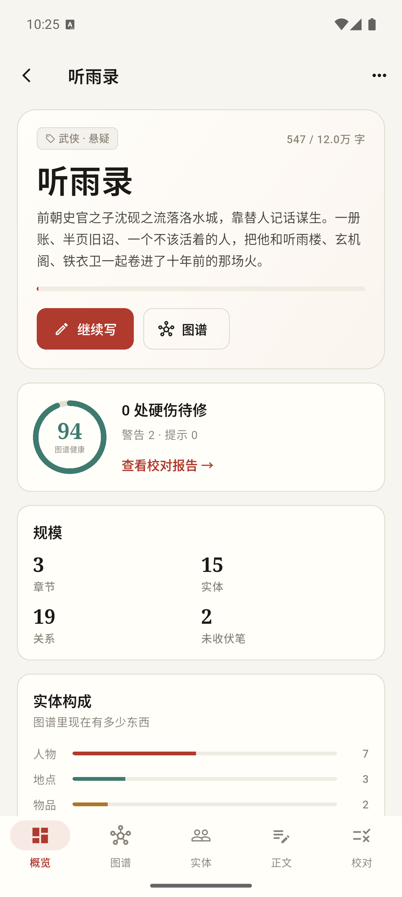

**图谱** — 力导向布局，颜色即类型，已故角色带斜杠，拖动可钉住节点

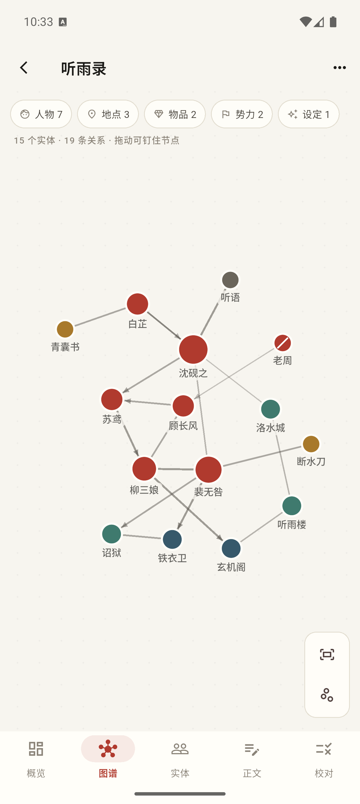

**实体档案** — 类型、别称（正文高亮会用到）、档案、重要度、出场章节、关系

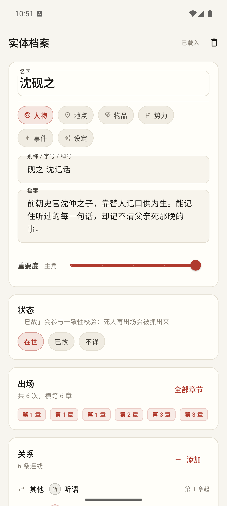

**正文编辑器** — 已建档的名字按类型染色，别名同样命中；底部是本章涉及的角色

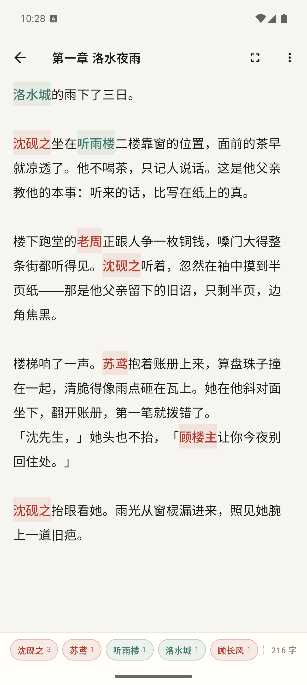

**实体速览** — 正文里点名字即开，关系带方向与生效章节

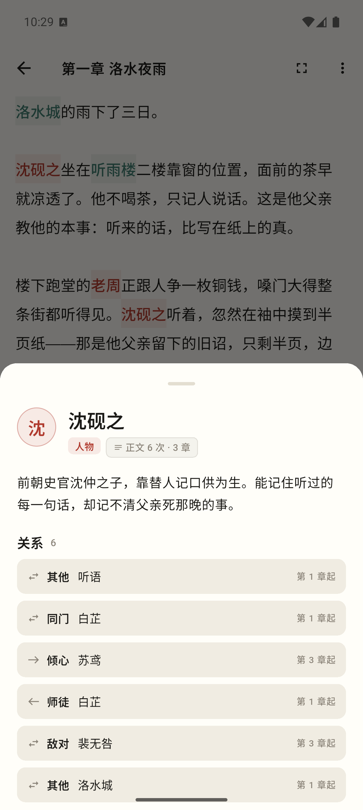

**校对** — 7 条确定性规则，健康度评分，每条可跳到对应章节

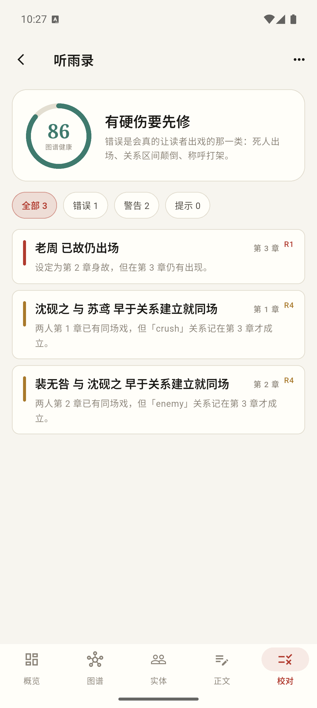

**关系演化** — 一条色带 = 一段关系的存活区间，颜色按关系类型

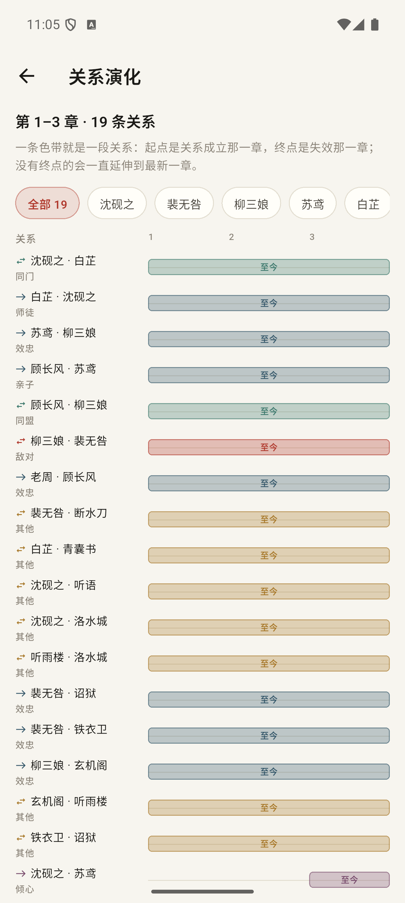

**导出** — 六种格式，走系统「另存为」，不经任何服务器

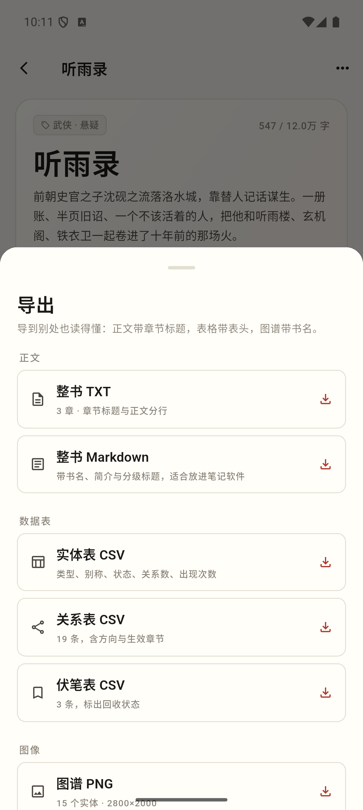

**图谱多选** — 长按进入多选，选中心实体后一次建出 N 条关系

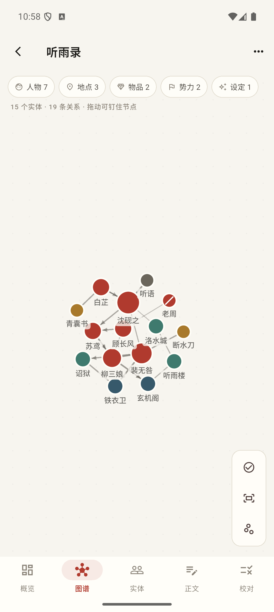

**章节快照** — 第 3 章：15 个实体、19 条关系，「本章变化」列出谁刚登场、哪条关系刚开始

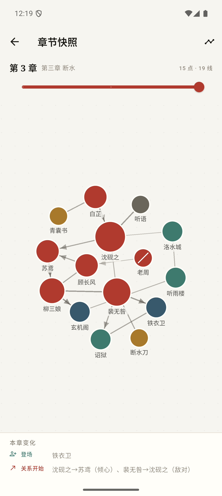

同一本书拨回第 1 章：只剩 10 个实体、9 条关系——这时候裴无咎还没出现，沈砚之还没对她动心

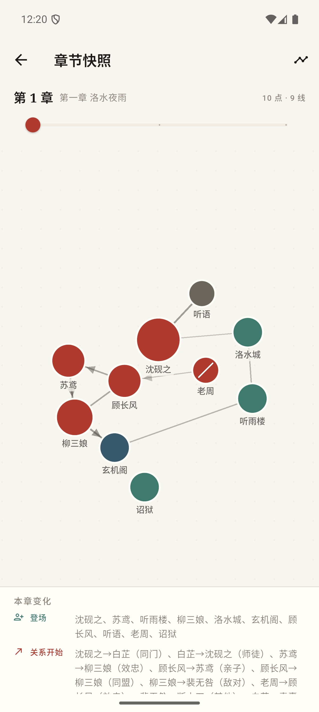

**GitHub 同步** — 填自己的私有仓库，每天自动一次，也可以随时手动点

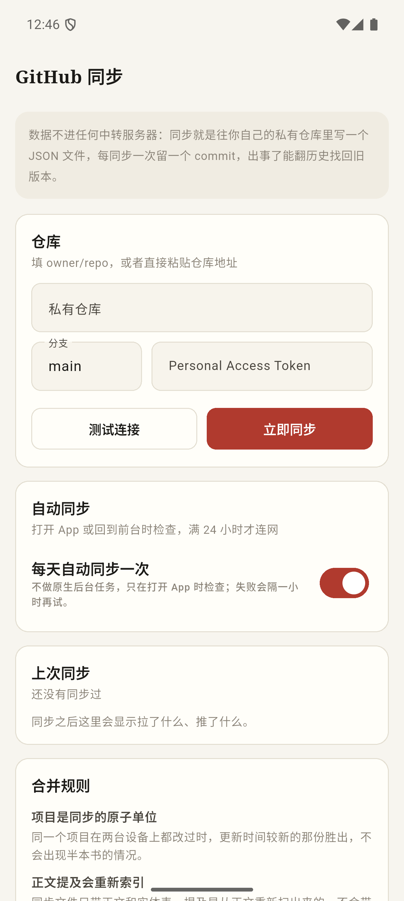

两边都改过同一本书时，不静默覆盖，逐本让你选：

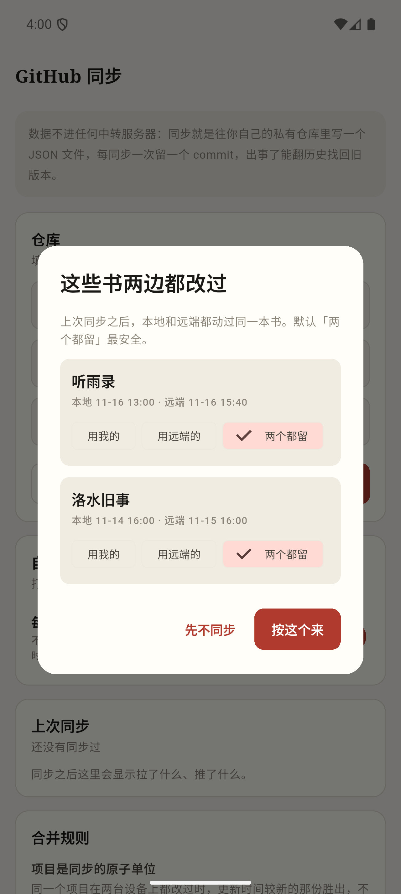

书架上直接能看到上次同步的结果，不用点进设置：


**回收站** — 长按作品移到回收站，底部立刻给一次撤销；删掉的书在这里躺 30 天


**正文检索** — 段落级检索，结果按章节分组；「只看沈砚之」= 他出现过的所有段落


每条结果下面直接挂着这一段里的出场人物和当时生效的关系数——检索不只是找字，是把结果接回图谱：


**写作提示** — 卡文时看的不是错误，是空档。概览上先给两条最值得动的：


点「全部」展开四类：档案没派上用场、同场多次却没连线、关系没写出来、重要角色缺席

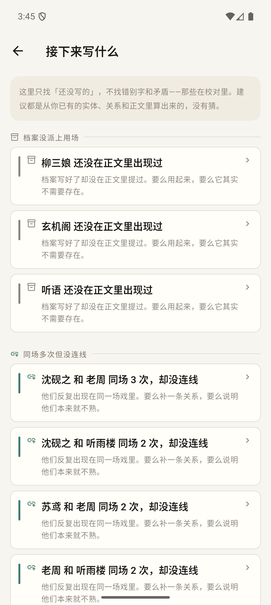

导出出来的图谱（2800×2000，带书名与统计）：

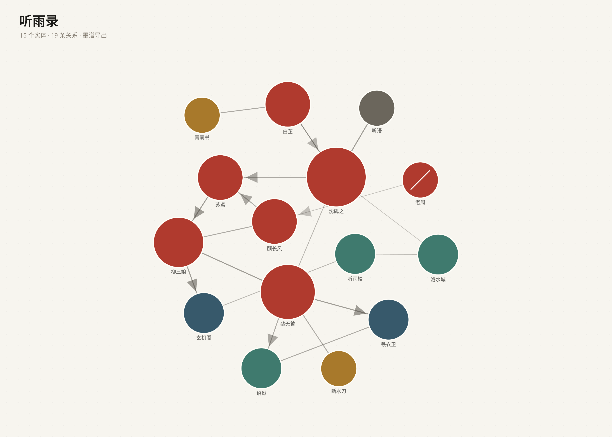

## 快速开始

```bash
flutter pub get
dart run build_runner build          # 生成 Drift 代码
flutter run                          # 手机 / 模拟器 / macOS 都可以
flutter test                         # 领域层单测
```

要求 Flutter 3.50+ / Dart 3.14+。

首次启动会自动铺一个示例项目《听雨录》：15 个实体、19 条关系、3 章正文。
其中**故意留了一处矛盾**——老周在第二章被写死，第三章又端着热酒出场——
打开「校对」就能看到 R1 规则抓到它。

## 目录结构

```
lib/
  main.dart / app.dart          启动 + 主题 + 路由装配
  providers.dart                Riverpod 数据流
  core/
    theme/                      墨色主题（宣纸 / 夜两套）
    widgets/                    通用组件
    router/                     go_router
    utils/                      字数统计、容错 JSON
  data/db/                      Drift 表定义 + 查询（含递归 CTE 子图）
  domain/
    taxonomy.dart               实体类型 / 关系类型 / 状态枚举
    graph/                      四叉树力导向、连通分量
    lint/                       7 条一致性规则
    text/                       正文实体识别（别名词典 + 最长优先）
    import/                     txt / md 分章
    llm/                        OpenAI 兼容协议客户端 + 配置存储
    seed/                       示例项目
  features/
    library/ project/ entities/ relations/ graph/ editor/ lint/ import/ settings/
```

## 一致性规则

| ID | 规则 | 级别 |
| --- | --- | --- |
| R1 | 死亡后出场：已故且提及在第 `deathChapter` 章之后 | 错误 |
| R2 | 关系区间倒挂：`validFrom > validTo` | 错误 |
| R3 | 称呼冲突：两个实体共用同一个名字或别称 | 错误 |
| R4 | 关系未立先同场：首次同场早于关系生效章 | 警告 |
| R5 | 伏笔超期未收：埋了 3 章以上仍未回收 | 警告 |
| R6 | 完全孤立：既无关系也无提及 | 提示 |
| R7 | 有出场但零关系 | 提示 |

健康度 = `100 - Σ(错误×8 + 警告×3 + 提示×1)`，下限 0。

## 三端同步是怎么做的

**数据仍然只存在本地 SQLite 里**，GitHub 仓库只是搬运通道，没有任何中转服务。

```
设备 A (SQLite) ──导出──► JSON 快照 ──Git Data API──► 私有仓库 mopu/library.json
                                                              │
设备 B (SQLite) ◄──合并──► JSON 快照 ◄──────────读────────────┘
```

- **同步单位是项目**：只有一边改过时 `updatedAt` 较新的胜出；**两边都改过同一本书时不会静默覆盖**，
  会停下来让你逐本选：用我的 / 用远端的 / 两个都留（把远端那份存成"xxx（远端副本）"）。
  靠一张 `SyncMarks` 表记住每次同步后两边的时间水位，才分得清"我改了"和"他改了"。
- **文件是人能读的 JSON**：关系用实体名字引用，不是内部 id；正文实体提及在导入时
  用正文重新扫一遍，不带脏位置过去。
- **每次都留一个 commit**：`墨谱同步 2026-11-16 12:30 · 3 个项目 · dev-a1b2c3d4`，
  写崩了能直接翻 git 历史找回上一版。
- **并发安全**：写 ref 时带 `force: false`，如果别的设备刚好抢先推了，PATCH 会失败，
  客户端重新拉取合并后重试，不会覆盖别人的提交。
- **删除分两步**：
  1. **移到回收站**（软删除）：`deletedAt` 记在项目上随同步走，所有设备都进各自的回收站，30 天内可恢复；
  2. **彻底删除**（或 30 天到期自动清理）：才真正删行并写墓碑 `{syncId, deletedAt, deviceId}`。
  墓碑决定跨设备一致性——本地 `updatedAt` 早于 `deletedAt` 就删，晚于它就保留并清墓碑（编辑晚于删除 = 复活）。
  没有墓碑的话，A 删了书，B 下次同步会把它原样推回仓库，书就"复活"了。
- **触发方式**：手动点「立即同步」，或每天自动一次——不引入原生后台任务
  （WorkManager / BGTaskScheduler 三端各要一套且系统随时可能不跑），
  改成「打开 App / 回到前台时检查，满 24 小时才连网，失败隔一小时再试」。
- **状态可见**：书架标题下有一行同步状态（未配置 / 尚未同步 / 3 小时前已同步 / 上次同步失败），
  点一下直达同步页。

仓库地址和 Token 由你自己填，Token 只存本机钥匙串（拿不到钥匙串时退回本地库）。
仓库名、分支、权限（需要 repo scope）都在设置页里说明。

## 技术选择与取舍

- **Drift + SQLite**，N 跳子图用递归 CTE，不引入图数据库：十万字量级（~10³ 实体）完全够用，省掉一整个服务端。
- **自研力导向**（CustomPainter + 四叉树）：需要控制节点样式、钉住、筛淡出，第三方包改不动。
- **不做中文分词**：实体表本身就是词典，按别名最长优先扫一遍，命中率比通用分词器高，且结果完全确定。
- **不做富文本**：Markdown 语法即可，换来长文输入性能。
- **AI 是可关的实验特性**：失败不影响主流程；Key 优先存系统钥匙串，取不到才退回本地库。

## 已验证环境

- Flutter 3.50.0（stable）/ Dart 3.14.0
- Android 15（API 35，arm64）模拟器：`flutter build apk --debug` 装包运行，
  书架 / 概览 / 图谱 / 实体列表 / 实体档案 / 正文 / 速览 / 校对 / 关系演化 / 导出 / 多选 逐页验证
- 导出链路端到端验证过：TXT 落到 `/sdcard/Download/听雨录_全文.txt`（2081 字节），
  PNG 落到 `/sdcard/Download/听雨录_图谱.png`（2800×2000，245 KB）
- 单元测试 77 项：分章、实体识别、力导向、字数统计、内存库读写、导出与 CSV 转义、
  章节快照规则、v1→v5 迁移、同步编码/合并/墓碑/GitHub 客户端、回收站软删除与到期清理、
  段落切分与正文检索（含 LIKE 通配符转义、按实体聚合）、段落线索（区间归属与关系生效判定）、
  写作提示的四条规则、同步冲突检测与三种处理方式
- 同步链路有一个内置的假 GitHub 服务器测试：A 设备推送、B 设备拉取并还原整本书、
  A 删除、B 跟着删、再同步一次不产生多余 commit、并发冲突抛异常后重试；
  两边各改一次时正确报冲突且不动数据，三种处理方式各自验证过
- v2 → v3（墓碑表）、v3 → v4（回收站字段）、v4 → v5（段落索引）都是真机上升级过的，
  老库直接可用；删除→回收站→恢复这条路径在设备上手动走了一遍，书完好回来
- 检索页在设备上验过：按实体筛选后，3 章共 6 段命中，分组与段数正确
- 写作提示在设备上验过：概览给出 8 条空档，其中「沈砚之 和老周 同场 3 次，却没连线」确实属实
- v1 → v2 迁移是在真机上跑的真升级（第一次就因为 SQLite 不允许 `ADD COLUMN ... UNIQUE` 挂了，
  现在有迁移回归测试守着）

## 已知边界

- 不做云同步 / 账号 / 协作：数据只在本机
- `Relation` 支持区间但不做"关系演化史"的差异视图
- 导出只做纯文本与世界模型表格，不做 docx / epub 排版
- 时间带固定铺满屏宽，章节特别多时色带会变细（暂不支持横向缩放）
- 多选只支持「中心 + 其余」的星型建边，不支持任意两两全连
- 同步按项目整体合并，不做章级/字段级 merge：两台设备同时改同一本书，只有较新的那份会留下
- 一年前的墓碑不再携带：离线超过一年的设备回来，认不出那本书曾被删除
- 「复活」是允许的：删除之后又改过的项目会被保留，并清掉墓碑（编辑晚于删除即胜出）
- 自动同步依赖"打开 App"这个动作，不是真正的后台定时任务；长期不打开就不会同步
- AI 抽取质量取决于模型，界面按"逐条复核"设计，不自动入库
